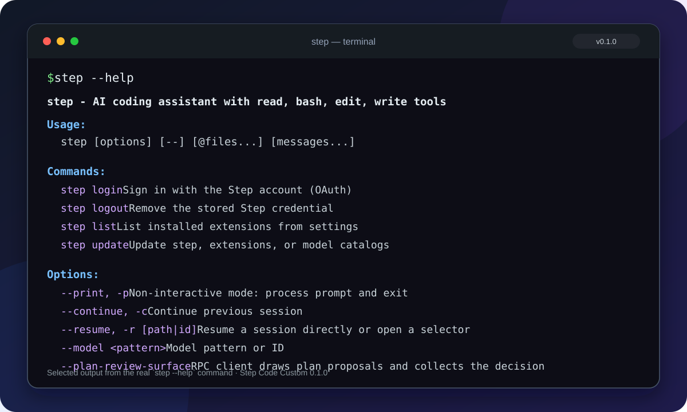
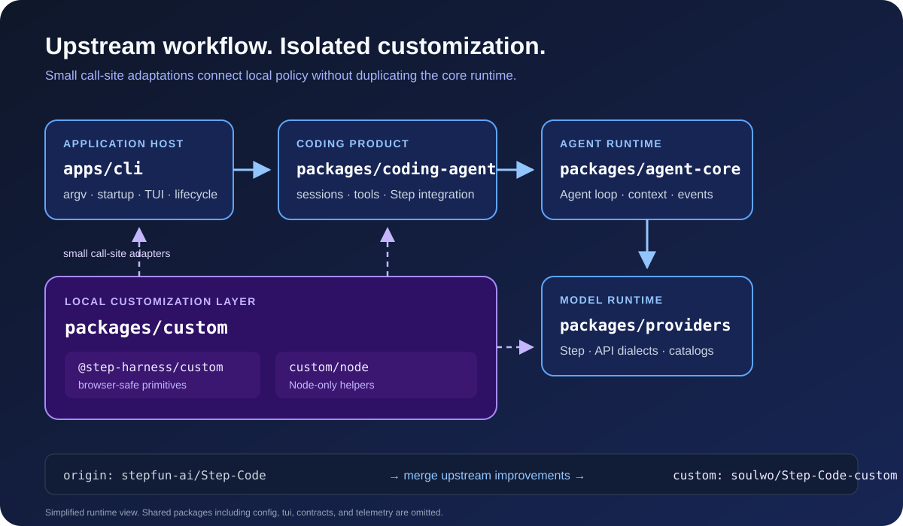

<h1 align="center">Step Code Custom</h1>

<p align="center">
  <strong>A privately maintained terminal coding assistant with isolated customization, reliable local state, and bounded runtime overhead.</strong>
</p>

<p align="center">
  <a href="https://github.com/soulwo/Step-Code-custom"></a>
  <a href="package.json"></a>
  
  
  <a href="LICENSE"></a>
  <a href="https://github.com/stepfun-ai/Step-Code"></a>
  <a href="https://github.com/soulwo/Step-Code-custom/actions/workflows/ci.yml"></a>
  <a href="https://github.com/soulwo/Step-Code-custom/actions/workflows/npm-audit.yml"></a>
</p>

<p align="center">
  <strong>English</strong> · <a href="README.zh-CN.md">简体中文</a><br>
  <a href="#what-is-different-from-upstream">Upstream comparison</a> ·
  <a href="#terminal-at-a-glance">Terminal</a> ·
  <a href="#why-step-code-custom">Features</a> ·
  <a href="#architecture">Architecture</a> ·
  <a href="#installation">Installation</a> ·
  <a href="#custom-configuration">Customization</a> ·
  <a href="docs/README.md">Documentation</a>
</p>

---

Step Code Custom is an independently maintained, private, customized downstream build based on [stepfun-ai/Step-Code](https://github.com/stepfun-ai/Step-Code). It preserves the upstream terminal coding-agent workflow while adding isolated local customization, reliability fixes, and performance improvements. It reads and modifies code, runs commands and tests, resumes sessions, and supports interactive or headless workflows. The original `step` command and existing configuration formats are preserved so current workflows continue to work.

This repository is owned and maintained at [soulwo/Step-Code-custom](https://github.com/soulwo/Step-Code-custom). It is not the upstream project's release page, and it does not publish official upstream installers.

## What is different from upstream

The repository continues to merge upstream improvements and maintains the following custom behavior on top of them. "Upstream baseline" identifies the integration point rather than scoring every feature in every upstream release.

| Area | Upstream baseline | Custom enhancement |
| --- | --- | --- |
| Custom code | Runtime modules | Reusable policy is isolated in `packages/custom` and connected through small adapters |
| State writes | Atomic replacement | Existing file permissions are preserved, including correct behavior under Linux umask |
| File and session I/O | Upstream scheduling | `find_stat` defaults to 32 concurrent reads and project session scans to 8 |
| Streaming JSON parsing | Upstream parsing policy | Intermediate blocks wait at least 24ms and 128 new characters by default; final blocks are always parsed completely |
| Model catalog | Upstream refresh policy | Fresh cache is used for 5 minutes by default and refreshed in the background |
| CLI builds | Application entrypoint | Both `apps/cli` and the standalone `packages/coding-agent` bundle are retained |

All defaults can be changed in a JSON file selected through `STEPCODE_CUSTOM_CONFIG`. See the [customization guide](docs/customization.md) for fields, validation, and recovery behavior.

## Terminal at a glance

<p align="center">
  
</p>

The terminal illustration uses selected output from the real `step --help` command in version 0.1.7. Run `pnpm step --help` from a source checkout to see the complete command reference.

## Why Step Code Custom

- **Complete coding loop** — inspect a repository, edit files, execute tools, and verify changes in an interactive TUI or with `step -p` for automation.
- **Clear execution outcomes** — distinguish command exit, timeout, signal, and output from tool-execution errors; show the applied diff when an edit fails after writing.
- **Recoverable plans and turns** — persist Plan decisions as session facts and recover interrupted or incomplete assistant turns across supported runtimes.
- **Step provider integration** — sign in with a Step Plan account or use a Step Platform API key, then select among the models returned by the active Step endpoint.
- **Long-running work** — delegate objectives with `/goal`, schedule work with `/cron`, and opt into multi-agent workflows with `/ultracode` or `/ultraloop`.
- **Adaptive context management** — compact automatically at configurable global or per-model context ratios, while preserving response room on smaller context windows.
- **Extension ecosystem** — use MCP servers, Agent Skills, plugins, and compatible Claude Code extensions.
- **StepPage integration** — publish local pages through the existing StepPage integration when it is configured and available.
- **Isolated customization** — local policies and utilities live in `packages/custom` instead of being scattered through upstream modules.
- **Reliability and performance improvements** — atomic writes for important state files, bounded file and session I/O, throttled intermediate JSON parsing, and model-catalog caching with background refresh.

## Architecture

<p align="center">
  
</p>

The upstream runtime remains layered: `apps/cli` hosts the application, `packages/coding-agent` owns coding workflows, `packages/agent-core` runs the agent loop, and `packages/providers` handles model APIs. Local policy enters through small adapters backed by `packages/custom`, rather than a second implementation inside each core module.

The diagram is intentionally simplified; shared packages such as `config`, `tui`, `contracts`, and `telemetry` are omitted. See the [customization guide](docs/customization.md) for package boundaries and configuration details.

## Installation

The supported installation path for this private repository is from source. You need Git, Node.js 22.19 or newer, and pnpm 9.15.9.

```bash
git clone https://github.com/soulwo/Step-Code-custom.git
cd Step-Code-custom
corepack enable
pnpm install --ignore-scripts
pnpm run build:offline
pnpm step
```

The offline build uses the model data already included in the repository. To download fresh model data and perform an online build, run `pnpm run build` instead.

From the source tree, use `pnpm step` wherever an installed CLI would use `step`:

```bash
pnpm step --version
pnpm step --help
```

## Sign in to the Step provider

The default entrypoint exposes one built-in model provider: **Step (StepFun)**. These profiles select the service region and billing method; they are not separate providers.

| Profile | Credential | Billing |
| --- | --- | --- |
| Step Plan (CN, [platform.stepfun.com](https://platform.stepfun.com/step-plan)) | Browser OAuth with automatic refresh | Usage included with Mini / Plus / Pro / Max plans |
| Step Plan Oversea ([platform.stepfun.ai](https://platform.stepfun.ai/step-plan)) | Browser OAuth with automatic refresh | Usage included with Mini / Plus / Pro / Max plans |
| Step Platform (CN) | API key from [platform.stepfun.com/interface-key](https://platform.stepfun.com/interface-key) | Pay per request |
| Step Platform Oversea | API key from [platform.stepfun.ai/interface-key](https://platform.stepfun.ai/interface-key) | Pay per request |

Inside the TUI, `/login` opens the sign-in flow; from a shell, run `step login`. For API-key access, set `STEP_API_KEY=<your_step_api_key>`, enter the key in `/login`, or pass `--api-key <your_step_api_key>` to a headless run.

`/status` shows session and model status. Use `step login status` or `step login status --json` to check the credential. Stored credentials live in `~/.stepcode/auth.json`; `/logout` clears the Step credential. After sign-in, `/model` lists models discovered from the active endpoint. A fresh model catalog is loaded from cache at startup and refreshed in the background.

## Getting started

In these examples, `step` means an installed CLI available on `PATH`. When running from this source checkout, keep using `pnpm step` from the repository root instead. Running `step` does not automatically select the current source tree.

Change into a project directory:

```bash
cd /path/to/your/project
step
```

Describe the task in the TUI, or submit one at launch:

```bash
step -p "Inspect this project's structure and explain how to run it locally."
```

Run `/init` to generate an `AGENTS.md` project guide. An existing `CLAUDE.md` is used as-is.

| Entry | Command | Use case |
| --- | --- | --- |
| Interactive TUI | `step` | Exploring code, ongoing conversations, reviewing changes |
| Headless | `step -p "..."` | Scripts, CI, and batch jobs |

### Examples

Read-only inspection:

```text
Inspect the main execution path and test setup. Do not modify any files.
```

A change with verification:

```text
Review the current API error handling, fix the confirmed defects, and run the relevant tests.
```

Multi-agent execution for one turn:

```bash
step -p "ultracode: Review the API changes and verify the tests"
```

Session-wide workflow controls are available through `/ultracode on`, `/ultracode off`, `/ultracode status`, and `/ultracode help`. `/ultraloop` is an exact alias. Workflow availability still depends on host and tool permissions.

### Resume a session

```bash
step -c   # Continue the most recent session
step -r   # Browse session history and choose one
```

Inside the TUI, `/resume` finds previous sessions and `/hotkeys` lists shortcuts.

### Common shortcuts

| Key | Action |
| --- | --- |
| `Enter` | Send a message, or queue it while a response is streaming |
| `Shift+Enter` / `Ctrl+J` / `Alt+Enter` | Insert a newline |
| `@` | Reference a project file |
| `!command` | Run a shell command and provide its output to the model |
| `Shift+Tab` | Cycle permission mode |
| `Ctrl+O` | Toggle tool output |
| `Esc` | Interrupt the running task |

## Custom configuration

Local customization primitives are exposed through `@step-harness/custom` and `@step-harness/custom/node`. See [packages/custom/README.md](packages/custom/README.md) for the extension and merge contract.

For a local JSON configuration, set `STEPCODE_CUSTOM_CONFIG` to the file path before starting the CLI:

```json
{
  "streamingParseIntervalMs": 24,
  "streamingParseMinChars": 128,
  "findStatConcurrency": 32,
  "sessionScanConcurrency": 8,
  "modelCatalogTtlMs": 300000,
  "suppressedWarningPatterns": ["SQLite"]
}
```

Set `streamingParseIntervalMs` to `0` for eager intermediate parsing, or `modelCatalogTtlMs` to `0` to force a startup catalog refresh.

### Adaptive context configuration

Set a global compaction ratio in `~/.stepcode/config.toml`, with optional overrides keyed by `provider/model-id`:

```toml
[compaction]
triggerRatio = 0.85

[compaction.modelTriggerRatios]
"provider/model-id" = 0.80
```

Ratios range from `0.50` through `0.95`, with a default of `0.90`. The v2 policy also preserves response room on smaller context windows. See [Adaptive context management](docs/context-management.md) for absolute token limits, defaults, and legacy behavior.

## Migrate from other agents

- **MCP configuration** — supported Claude Code and Codex MCP configuration can be imported on first launch without modifying the source files or inlining secrets.
- **Plugins** — compatible Claude Code plugins can be managed through `/plugin`.
- **Project guides** — an existing `CLAUDE.md` remains usable; `/init` generates the equivalent `AGENTS.md`.

## Sync with upstream

This checkout uses two remotes: `origin` tracks `stepfun-ai/Step-Code`, while `custom` points to the private `soulwo/Step-Code-custom` repository. Bring in upstream changes without publishing private work upstream:

```bash
git fetch origin
git merge origin/main
pnpm install --frozen-lockfile --ignore-scripts
pnpm run build:offline
pnpm run check
git push custom main
```

Resolve any conflicts before running the verification commands. The [upstream synchronization guide](docs/upstream-sync.md) explains conflict hotspots, merge-abort recovery, and the custom-package preservation rules.

## Build and verification

After changing the source:

```bash
pnpm run build:offline
pnpm run check
./test.sh
```

The full test script isolates user credentials and temporary resources. Some platform-specific suites may require Bash, Git, or symlink permission on Windows; report environment limitations separately from code failures.

See the [performance verification guide](docs/performance.md) for reproducible startup, cache, and configuration measurements. Do not claim a specific speedup without comparable measurements.

The current version is **0.1.7**, checked against the official package, checksum, real help output, and every release item; see the [0.1.7 synchronization review](docs/release-0.1.7.md). Full verification also covers real CLI/bundle/RPC entrypoints, Linux sandbox effects, and production dependency auditing. Final cloud totals include 5274 coding-agent, 762 apps/cli, 560 agent-core, and 481 provider tests passing. See [verification evidence](docs/verification.md) for methods, the initial test-attempt fluctuation, and coverage boundaries.

## Security

Permission tiers are **Ask**, **Approve for Me**, and **Full Access**, cycled with `Shift+Tab`. Review tool calls and use the least permissive mode suitable for the task. Read [SECURITY.md](SECURITY.md) before reporting a vulnerability or loading third-party extensions.

The main CI runs Build, Check, and Test, while the scheduled `npm audit` checks current production-dependency advisories. Neither substitutes for the other. Reproduce the production audit locally with:

```bash
pnpm audit --prod --audit-level moderate
```

Audit failures generally require compatible dependency and lockfile updates; they should not be hidden by disabling the audit or skipping checks.

## Uninstall

For a source installation, close running sessions and remove the cloned repository. Local configuration, credentials, sessions, and logs are stored under `~/.stepcode`; remove that directory only when you no longer need them.

## Documentation and community

- [Documentation index](docs/README.md) — product, runtime, customization, and maintenance guides
- [Customization guide](docs/customization.md) — defaults, validation, package boundaries, and extension workflow
- [Customization package contract](packages/custom/README.md) — public entry points and merge constraints
- [Upstream synchronization](docs/upstream-sync.md) — private development and upstream merge procedure
- [Adaptive context management](docs/context-management.md) — ratios, per-model overrides, and response headroom
- [Performance verification](docs/performance.md) — reproducible startup, cache, and configuration measurements
- [Verification evidence](docs/verification.md) — upstream baseline, real entrypoints, cloud tests, and coverage boundaries
- [Step Code 0.1.7 synchronization](docs/release-0.1.7.md) — official release verification and feature mapping
- [Troubleshooting](docs/troubleshooting.md) — installation, commands, CI, audits, and platform limitations
- [Development guide](docs/development.md) · [Testing guide](docs/testing.md)
- [Contribution guide](contribute.md) · [Security policy](SECURITY.md)
- [Issues](https://github.com/soulwo/Step-Code-custom/issues)
- [Upstream repository](https://github.com/stepfun-ai/Step-Code), used only for tracking upstream changes

When filing an issue, include `step --version`, the commit SHA, reproduction steps, and the command used. Remove credentials and private project content first.

## License

Released under the MIT license; see [LICENSE](LICENSE).
