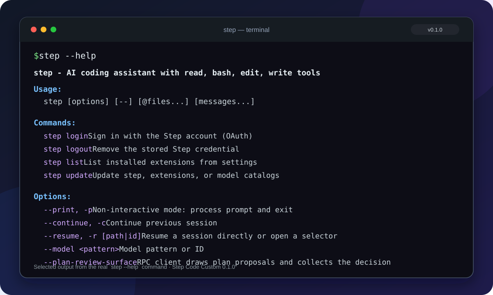
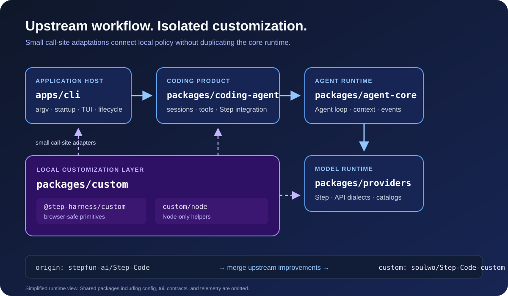

<h1 align="center">Step Code Custom</h1>

<p align="center">
  <strong>独立维护的终端编程助手：定制代码隔离、本地状态可靠、运行开销可控。</strong>
</p>

<p align="center">
  <a href="https://github.com/soulwo/Step-Code-custom"></a>
  <a href="package.json"></a>
  
  
  <a href="LICENSE"></a>
  <a href="https://github.com/stepfun-ai/Step-Code"></a>
  <a href="https://github.com/soulwo/Step-Code-custom/actions/workflows/ci.yml"></a>
  <a href="https://github.com/soulwo/Step-Code-custom/actions/workflows/npm-audit.yml"></a>
</p>

<p align="center">
  <a href="README.md">English</a> · <strong>简体中文</strong><br>
  <a href="#与官方上游的区别">与官方区别</a> ·
  <a href="#终端展示">终端展示</a> ·
  <a href="#项目特性">项目特性</a> ·
  <a href="#项目架构">项目架构</a> ·
  <a href="#安装">安装</a> ·
  <a href="#自定义配置">自定义配置</a> ·
  <a href="docs/README.md">文档索引</a>
</p>

---

Step Code Custom 是基于上游 [stepfun-ai/Step-Code](https://github.com/stepfun-ai/Step-Code) 开发的独立维护、私有、自定义下游版本。在保留上游终端编程助手工作流的基础上，加入隔离的本地定制、可靠性修复和性能优化。项目支持代码阅读与修改、命令和测试执行、会话恢复，以及交互式和无界面两种使用方式，并保留原有 `step` 命令和配置格式，现有工作流无需因本次定制而改变。

本仓库由 [soulwo/Step-Code-custom](https://github.com/soulwo/Step-Code-custom) 维护，不是上游项目的官方发布页，也不提供上游官方安装器。

## 与官方上游的区别

本仓库持续合并官方上游改进，并在此基础上维护以下定制。表中“上游基线”用于说明接入位置，不代表对上游所有版本的逐项功能评价。

| 维度 | 上游基线 | 本仓库的定制增强 |
| --- | --- | --- |
| 定制代码 | 各运行时模块 | 可复用策略集中在 `packages/custom`，通过小型适配器接入 |
| 状态写入 | 原子替换 | 同时继承原文件权限，并处理 Linux umask，避免重写后权限收窄 |
| 文件与会话 I/O | 上游调度 | `find_stat` 默认 32 并发，项目会话扫描默认 8 并发 |
| 流式 JSON 解析 | 上游解析策略 | 默认至少间隔 24ms 且新增 128 字符再解析中间块，最终块始终完整解析 |
| 模型目录 | 上游刷新策略 | 新鲜缓存默认保留 5 分钟，启动直接使用并在后台刷新 |
| CLI 构建 | 应用入口 | 保留 `apps/cli`，同时提供 `packages/coding-agent` 的独立 bundle |

这些默认值均可通过 `STEPCODE_CUSTOM_CONFIG` 指向的 JSON 文件调整；字段、校验和恢复方式见[定制指南](docs/customization.md)。

## 终端展示

<p align="center">
  
</p>

终端图使用 0.1.7 版本真实 `step --help` 输出的精选内容。在源码目录运行 `pnpm step --help` 可查看完整命令说明。

## 项目特性

- **完整编程闭环**：在交互式 TUI 中检查仓库、修改文件、执行工具并验证结果，也可通过 `step -p` 用于自动化任务。
- **明确的执行结果**：区分命令退出、超时、信号与工具错误；编辑调用在写入后失败时仍展示实际变更。
- **可恢复的计划与轮次**：将 Plan 决定保存为会话事实，并为中断或不完整的助手轮次提供恢复处理。
- **后台任务生命周期**：按会话管理后台进程与子代理，支持 `/ps`、`/subagents`、会话级定时任务和并发设置，退出时执行明确清理。
- **实时 Git 上下文**：系统提示不固化分支和未提交文件数；分支变化时注入隐藏运行时上下文，保持缓存前缀稳定。
- **Step provider 接入**：支持 Step Plan 账号登录和 Step Platform API Key，并可切换当前 Step endpoint 返回的模型。
- **长任务与多代理**：通过 `/goal` 管理持续目标，通过 `/cron` 定时执行，通过 `/ultracode` 或 `/ultraloop` 启用多代理工作流。
- **自适应上下文管理**：支持按全局或单模型上下文比例自动压缩，并为较小上下文窗口保留足够的响应空间。
- **扩展生态**：支持 MCP 服务器、Agent Skills、插件及兼容的 Claude Code 扩展。
- **StepPage 集成**：配置且服务可用时，沿用现有 StepPage 能力发布本地页面。
- **定制逻辑隔离**：本地策略和工具集中在 `packages/custom`，避免散落在上游核心模块。
- **可靠性与性能改进**：关键状态原子写入、文件与会话 I/O 限流、流式 JSON 中间解析限频，以及模型目录缓存和后台刷新。

## 项目架构

<p align="center">
  
</p>

上游运行时保持原有分层：`apps/cli` 负责应用宿主，`packages/coding-agent` 负责编程工作流，`packages/agent-core` 运行 Agent Loop，`packages/providers` 处理模型 API。本地策略通过 `packages/custom` 和小型接入点进入各模块，不在核心代码中重复维护另一套实现。

架构图采用简化视图，省略了 `config`、`tui`、`contracts` 和 `telemetry` 等共享包。包边界与配置细节见[定制指南](docs/customization.md)。

## 安装

本私有仓库目前通过源码安装。需要 Git、Node.js 22.19 或更高版本，以及 pnpm 9.15.9。

```bash
git clone https://github.com/soulwo/Step-Code-custom.git
cd Step-Code-custom
corepack enable
pnpm install --ignore-scripts
pnpm run build:offline
pnpm step
```

离线构建使用仓库已有的模型数据。需要下载最新模型数据时，改用 `pnpm run build`。

在源码目录中，将安装版命令里的 `step` 替换为 `pnpm step`：

```bash
pnpm step --version
pnpm step --help
```

## 登录 Step provider

默认入口内置一个模型 provider：**Step（StepFun）**。以下入口只代表不同区域和计费方式，不是不同 provider。

| 入口 | 鉴权方式 | 计费 |
| --- | --- | --- |
| Step Plan（国内，[platform.stepfun.com](https://platform.stepfun.com/step-plan)） | 浏览器 OAuth，凭据自动刷新 | Mini / Plus / Pro / Max 订阅内含用量 |
| Step Plan Oversea（海外，[platform.stepfun.ai](https://platform.stepfun.ai/step-plan)） | 浏览器 OAuth，凭据自动刷新 | Mini / Plus / Pro / Max 订阅内含用量 |
| Step Platform（国内） | 从 [platform.stepfun.com/interface-key](https://platform.stepfun.com/interface-key) 获取 API Key | 按请求计费 |
| Step Platform Oversea（海外） | 从 [platform.stepfun.ai/interface-key](https://platform.stepfun.ai/interface-key) 获取 API Key | 按请求计费 |

在 TUI 中输入 `/login` 启动登录流程，也可在 shell 中运行 `step login`。使用 API Key 时，可设置 `STEP_API_KEY=<your_step_api_key>`、在 `/login` 中输入，或在无界面运行时传入 `--api-key <your_step_api_key>`。

`/status` 用于查看会话和模型状态；`step login status` 或 `step login status --json` 用于检查凭据。凭据保存在 `~/.stepcode/auth.json`，`/logout` 用于清除。登录后，`/model` 显示当前 endpoint 返回的模型。新鲜模型目录在启动时直接使用，并在后台刷新。

## 上手

以下示例中的 `step` 指已经加入 `PATH` 的安装版命令；使用本仓库源码时，请在源码根目录继续将其替换为 `pnpm step`。直接运行 `step` 不会自动选择当前源码目录。

进入项目目录：

```bash
cd /path/to/your/project
step
```

在 TUI 中描述任务，或启动时直接提交：

```bash
step -p "检查这个项目的结构，并说明如何在本地运行。"
```

使用 `/init` 生成 `AGENTS.md` 项目指引；已有 `CLAUDE.md` 可直接使用。

| 入口 | 命令 | 适用场景 |
| --- | --- | --- |
| 交互式 TUI | `step` | 探索代码、持续对话、审阅修改 |
| 无界面 | `step -p "..."` | 脚本、CI 和批处理 |

### 示例

只读检查：

```text
检查主要执行链和测试结构，不要修改任何文件。
```

修改并验证：

```text
检查当前 API 错误处理，修复已确认的问题，并运行相关测试。
```

单轮多代理执行：

```bash
step -p "ultracode: Review the API changes and verify the tests"
```

会话级工作流可使用 `/ultracode on`、`/ultracode off`、`/ultracode status` 和 `/ultracode help` 控制；`/ultraloop` 是等价别名。工作流是否可用仍取决于宿主和工具权限。

### 恢复会话

```bash
step -c   # 继续最近一次会话
step -r   # 浏览历史会话并选择
```

TUI 内使用 `/resume` 查找历史会话，使用 `/hotkeys` 查看快捷键。

### 常用快捷键

| 快捷键 | 操作 |
| --- | --- |
| `Enter` | 发送消息；流式输出时排队 |
| `Shift+Enter` / `Ctrl+J` / `Alt+Enter` | 换行 |
| `@` | 引用项目文件 |
| `!命令` | 执行 Shell 命令并将输出提供给模型 |
| `Shift+Tab` | 循环权限模式 |
| `Ctrl+O` | 折叠或展开工具输出 |
| `Esc` | 中断当前任务 |

## 自定义配置

本地定制能力通过 `@step-harness/custom` 和 `@step-harness/custom/node` 提供，扩展与合并约定见 [packages/custom/README.md](packages/custom/README.md)。

使用 JSON 配置时，在启动前将 `STEPCODE_CUSTOM_CONFIG` 指向配置文件：

```json
{
  "streamingParseIntervalMs": 24,
  "streamingParseMinChars": 128,
  "findStatConcurrency": 32,
  "sessionScanConcurrency": 8,
  "modelCatalogTtlMs": 300000,
  "suppressedWarningPatterns": ["SQLite"]
}
```

将 `streamingParseIntervalMs` 设为 `0` 可恢复每个中间块都解析；将 `modelCatalogTtlMs` 设为 `0` 可强制启动时刷新模型目录。

### 自适应上下文配置

在 `~/.stepcode/config.toml` 中设置全局压缩比例，也可按 `provider/model-id` 覆盖单个模型：

```toml
[compaction]
triggerRatio = 0.85

[compaction.modelTriggerRatios]
"provider/model-id" = 0.80
```

比例有效范围为 `0.50` 到 `0.95`，默认值为 `0.90`。v2 策略还会为小上下文窗口保留下一次响应所需空间。完整配置、绝对 token 上限和 legacy 恢复方式见[自适应上下文管理](docs/context-management.md)。

## 从其他 Agent 迁移

- **MCP 配置**：可导入支持的 Claude Code 和 Codex MCP 配置，不修改源文件，也不把密钥内联。
- **插件**：兼容的 Claude Code 插件可通过 `/plugin` 管理。
- **项目指引**：已有 `CLAUDE.md` 可直接使用，`/init` 可生成对应的 `AGENTS.md`。

## 同步上游更新

当前仓库使用两个远程：`origin` 跟踪 `stepfun-ai/Step-Code`，`custom` 指向私有的 `soulwo/Step-Code-custom`。以下流程将上游更新合并到本地，验证后只推送到私有仓库：

```bash
git fetch origin
git merge origin/main
pnpm install --frozen-lockfile --ignore-scripts
pnpm run build:offline
pnpm run check
git push custom main
```

如有冲突，先解决冲突再执行验证。[上游同步指南](docs/upstream-sync.md)列出了重点冲突区域、中止合并的方法和定制包保留规则。

## 构建与验证

修改源码后运行：

```bash
pnpm run build:offline
pnpm run check
./test.sh
```

完整测试脚本会隔离用户凭据和临时资源。Windows 下部分测试可能需要 Bash、Git 或 symlink 权限；环境限制应与代码失败分别报告。

启动性能、冷/热缓存和定制参数的可复现测量方法见[性能验证指南](docs/performance.md)；没有实测数据时不声明具体提速百分比。

当前版本为 **0.1.7**，已核对官方发布包、校验和、真实帮助输出及全部发布项；逐项实现与测试见 [0.1.7 同步说明](docs/release-0.1.7.md)。完整复核还覆盖真实 CLI/bundle/RPC、Linux sandbox 和生产依赖审计，最新 Git 上下文与后台生命周期复核结果为 coding-agent 5352 项、apps/cli 762 项、Agent Core 560 项、Provider 484 项通过；测试方法、首次波动与覆盖边界见[验证证据](docs/verification.md)。

## 安全

权限分为 **Ask**、**Approve for Me** 和 **Full Access**，通过 `Shift+Tab` 切换。请审阅工具调用，并选择满足任务需要的最低权限。加载第三方扩展或报告漏洞前，请阅读 [SECURITY.md](SECURITY.md)。

主 CI 负责 Build、Check 和 Test，定时 `npm audit` 负责生产依赖公告检查，两者互不代表。可在本地复现生产依赖审计：

```bash
pnpm audit --prod --audit-level moderate
```

审计失败通常需要兼容的依赖与锁文件升级，不应通过关闭审计或跳过检查掩盖。

## 卸载

源码安装可直接删除克隆目录，删除前请关闭正在运行的会话。配置、凭据、会话和日志默认位于 `~/.stepcode`；只有确认不再需要这些数据时，才删除该目录。

## 文档与社区

- [文档索引](docs/README.md)：产品、运行时、定制与维护文档
- [定制指南](docs/customization.md)：默认值、参数校验、包边界和扩展流程
- [定制包约定](packages/custom/README.md)：公开入口与合并约束
- [上游同步指南](docs/upstream-sync.md)：私有开发与上游合并流程
- [自适应上下文管理](docs/context-management.md)：压缩比例、单模型覆盖与响应空间保护
- [性能验证指南](docs/performance.md)：可复现的启动、缓存与配置测量
- [验证证据](docs/verification.md)：上游基线、真实入口、云端测试与覆盖边界
- [0.1.7 同步说明](docs/release-0.1.7.md)：官方发布核验与逐项功能对照
- [故障排查](docs/troubleshooting.md)：安装、命令、CI、审计和平台限制
- [开发指南](docs/development.md) · [测试指南](docs/testing.md)
- [贡献指南](contribute.md) · [安全政策](SECURITY.md)
- [问题反馈](https://github.com/soulwo/Step-Code-custom/issues)
- [上游仓库](https://github.com/stepfun-ai/Step-Code)，仅用于跟踪上游更新

提交 Issue 时，请附上 `step --version`、提交 SHA、复现步骤和运行命令，并先删除凭据和私人项目内容。

## 许可

本项目以 MIT 许可发布，详见 [LICENSE](LICENSE)。
