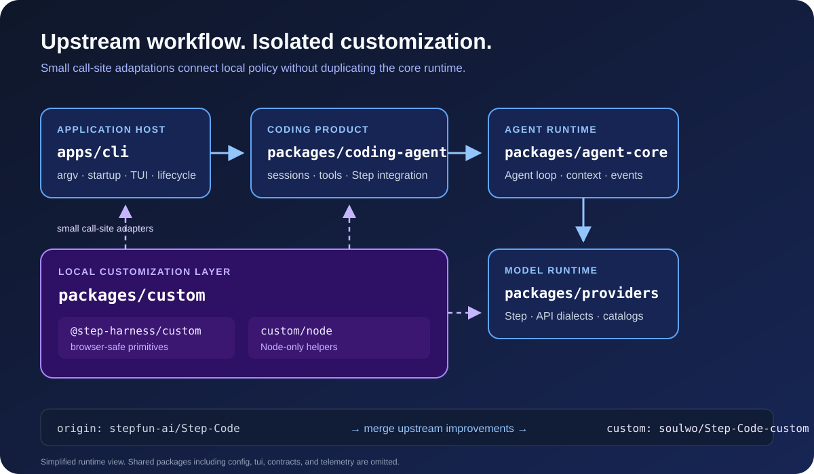

# Customization guide

Step Code Custom keeps local policy in `packages/custom`. Upstream modules retain their existing responsibilities and call this package through small adapters. This makes upstream merges easier to review and gives local tuning one configuration entry point.



## Package boundaries

| Entry point | Runtime | Responsibilities |
| --- | --- | --- |
| `@step-harness/custom` | Browser-safe | Configuration, bounded concurrency, streaming-parse scheduling, model-catalog freshness |
| `@step-harness/custom/node` | Node.js only | Atomic file writes, selective warning filtering, JSON configuration loading |

Do not import `@step-harness/custom/node` from browser-facing code. The repository browser smoke check enforces this boundary.

## Configuration file

Create a JSON file outside the repository when it contains machine-specific settings, then point `STEPCODE_CUSTOM_CONFIG` at it. The CLI and Bun entrypoints load this file during startup.

Bash:

```bash
export STEPCODE_CUSTOM_CONFIG="$HOME/.stepcode/custom.json"
step
```

Windows PowerShell:

```powershell
$env:STEPCODE_CUSTOM_CONFIG = "$HOME\.stepcode\custom.json"
step
```

Example `custom.json`:

```json
{
  "streamingParseIntervalMs": 24,
  "streamingParseMinChars": 128,
  "findStatConcurrency": 32,
  "sessionScanConcurrency": 8,
  "modelCatalogTtlMs": 300000,
  "suppressedWarningPatterns": ["SQLite"]
}
```

Unset `STEPCODE_CUSTOM_CONFIG` to use the built-in defaults. Missing keys also use their defaults. Invalid values fail configuration loading instead of being silently ignored.

## Defaults and behavior

| Key | Default | Behavior |
| --- | ---: | --- |
| `streamingParseIntervalMs` | `24` | Minimum milliseconds between intermediate parses of one streaming tool call. `0` restores eager intermediate parsing. |
| `streamingParseMinChars` | `128` | Minimum new characters before another intermediate parse. Must be a positive integer. |
| `findStatConcurrency` | `32` | Maximum concurrent metadata reads used by `find_files`. Must be a positive integer. |
| `sessionScanConcurrency` | `8` | Maximum concurrent project-directory session scans. Must be a positive integer. |
| `modelCatalogTtlMs` | `300000` | Fresh-cache lifetime in milliseconds. `0` forces a startup catalog refresh. |
| `suppressedWarningPatterns` | `["SQLite"]` | Warning text fragments filtered by the CLI. Other warnings pass through. |

Final streaming tool-call blocks are always parsed completely, regardless of the intermediate scheduling settings.

## Programmatic configuration

Embedding hosts can configure the same primitives in code:

```ts
import { configureCustom } from "@step-harness/custom";

configureCustom({
  streamingParseIntervalMs: 24,
  findStatConcurrency: 32,
  sessionScanConcurrency: 8,
  modelCatalogTtlMs: 300000,
});
```

Programmatic configuration replaces the active configuration with the supplied values plus defaults for omitted keys.

## Adding another customization

1. Put reusable local policy or utilities in `packages/custom`.
2. Keep browser-safe and Node-only exports separate.
3. Add or extend a small call-site adapter in the owning upstream module.
4. Add focused tests in `packages/custom/test` and the affected consumer package.
5. Run the following from the repository root:

```bash
pnpm run build:offline
pnpm run check
```

See the [package contract](../packages/custom/README.md) for the public entry points and the [upstream synchronization guide](upstream-sync.md) for merge procedure.
